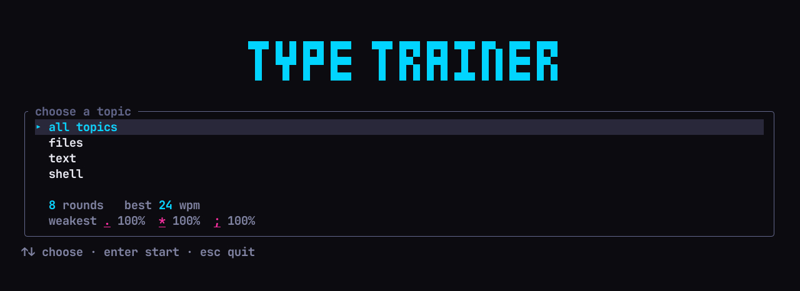

# terminal-typing-trainer

A typing trainer for your terminal, in the spirit of monkeytype and keybr, that
drills real Linux sysadmin commands instead of English words. These are the
commands full of `| & ; > >> 2>&1 $() {} [] ^ ~ \ ' "` that slow you down at a
shell prompt.



While you type, the panel shows your live speed and time, with a progress bar
underneath:

```
╭ type ───────────────────────────────────────── 42 wpm · 0:07 ╮
│ find /var/log -name '*.log' -mtime +7 -exec gzip {} \;       │
╰──────────────────────────────────────────────────────────────╯
━━━━━━━━━━━━━━━━━━━━━━━━━━━━━━━━━━━━━━━━━━━━━━━━━━━━━━━━━━━━━━━━
esc menu
```

## Features

- **31 real commands** in three topics: files (`find`, `xargs`, `tar`, permissions),
  text (`grep`, `sed`, `awk`, `sort`) and shell (redirection, `$()`, `&&`/`||`, loops).
- **Live feedback while you type:** speed and time in the panel border, a progress
  bar, and every mistake marked in place with the character you should have typed.
  The border flashes when you hit a wrong key.
- **Results after each round:** wpm, accuracy, the symbols you missed and a
  one-line explanation of what the command does. Corrected mistakes still count
  against accuracy.
- **Practises what you're bad at.** It tracks how often you miss each symbol and
  picks commands containing your weak ones more often.
- **Stats are saved between runs**, including your best wpm and weakest symbols.
- **Safe:** the commands are display text only. Nothing is ever executed.

## Install and run

You need Rust 1.88 or newer ([rustup.rs](https://rustup.rs)).

```sh
git clone https://github.com/nicomts/terminal-typing-trainer.git
cd terminal-typing-trainer
cargo run --release
```

To install it as a `terminal-typing-trainer` command:

```sh
cargo install --path .
```

## Keys

| Screen  | Key                | Action                              |
| ------- | ------------------ | ----------------------------------- |
| Menu    | `↑` `↓` or `k` `j` | choose a topic                      |
|         | `Enter`            | start                               |
|         | `Esc` or `q`       | quit                                |
| Typing  | any character      | type it                             |
|         | `Backspace`        | delete the last character           |
|         | `Esc`              | back to the menu (round is dropped) |
| Results | `Enter`            | next command, same topic            |
|         | `Esc`              | back to the menu                    |

## Where stats are saved

| OS      | Path |
| ------- | ---- |
| Linux   | `~/.local/share/terminal-typing-trainer/stats.json` |
| macOS   | `~/Library/Application Support/terminal-typing-trainer/stats.json` |
| Windows | `%APPDATA%\terminal-typing-trainer\data\stats.json` |

Delete the file to reset your stats.

## Adding commands

Commands live in `corpus/`, one TOML file per topic, and are built into the binary.
Use TOML's literal multi-line strings (`'''…'''`) for `text`, so quotes and
backslashes are stored exactly as typed:

```toml
[[command]]
text = '''find /var/log -name '*.log' -mtime +7 -exec gzip {} \;'''
explain = "Compress logs older than 7 days"
tags = ["find", "exec"]
```

Each command is checked when it loads: `text` can't be empty, contain tabs or
newlines, or start or end with a space; `explain` must be 56 characters or fewer;
and there must be at least one tag. Run `cargo test` to check your changes.

## Development

```sh
cargo fmt
cargo clippy --all-targets -- -D warnings
cargo test
```

The screens are covered by [insta](https://insta.rs) snapshot tests. After a layout
change, review the new snapshots with `cargo insta review` (install it with
`cargo install cargo-insta`). [`CLAUDE.md`](CLAUDE.md) describes the architecture
and the project's rules.

Built with [ratatui](https://ratatui.rs). No async runtime: one loop polls for keys
and redraws about 30 times a second.

---

Built while learning Rust, as a project to try Claude Code.
