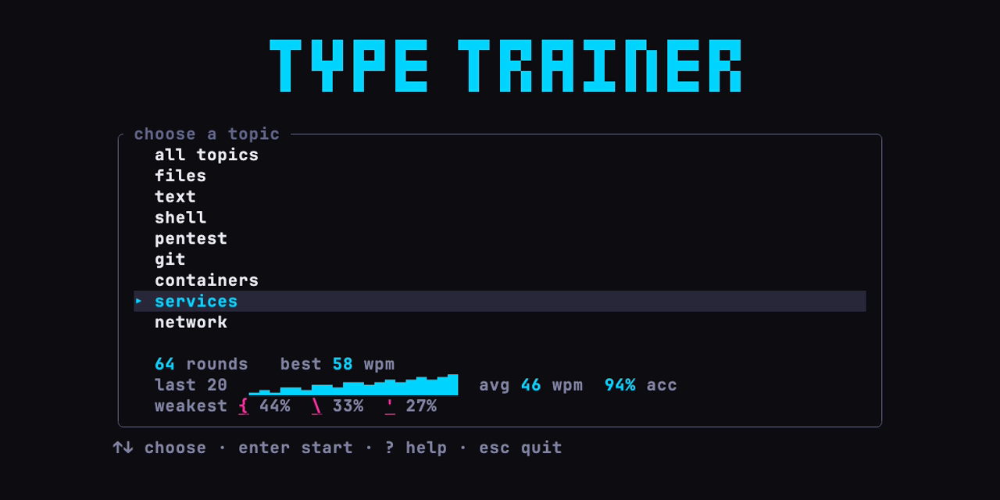
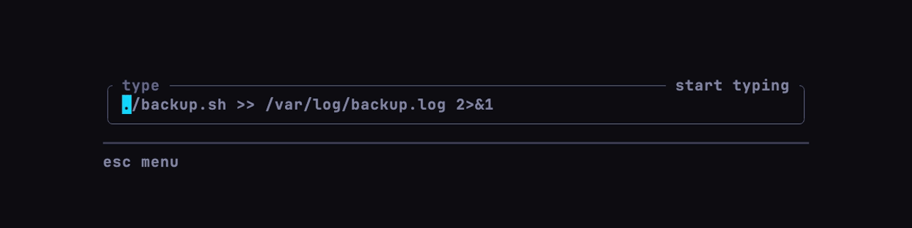
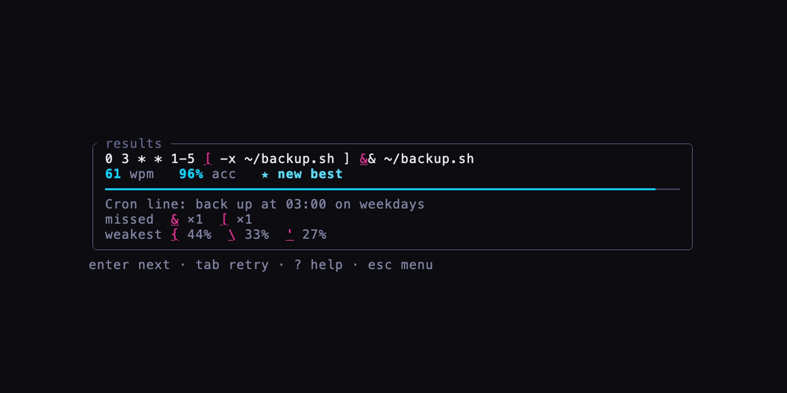
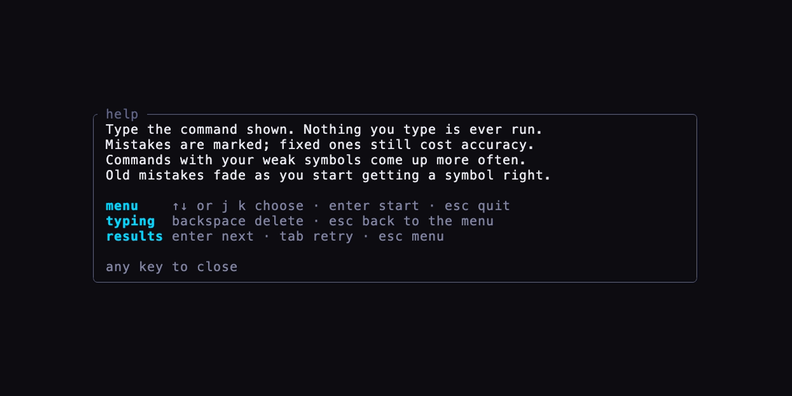

# terminal-typing-trainer

A typing trainer for your terminal, in the spirit of monkeytype and keybr, that
drills real Linux sysadmin commands instead of English words. These are the
commands full of `| & ; > >> 2>&1 $() {} [] ^ ~ \ ' "` that slow you down at a
shell prompt.

**Try it in your browser:** <https://nicomts.github.io/terminal-typing-trainer/>



While you type, the panel shows your live speed and time, with a progress bar
underneath. A wrong key flashes the border and is marked in place:



After each round you get your speed and accuracy, what the command does, the
symbols you missed and your weakest symbols overall:



Press `?` on the menu or results screen for help:



## Features

- **81 real commands** in eight topics: files (`find`, `xargs`, `tar`, permissions),
  text (`grep`, `sed`, `awk`, `sort`), shell (redirection, `$()`, `&&`/`||`, loops),
  pentest (`nmap`, `ss`, `openssl`, `tcpdump`: recon and auditing your own hosts),
  git (log formats, stashes, reflog), containers (`docker` run, exec, `{{.Format}}`),
  services (`systemctl`, `journalctl`, cron lines) and network (`ssh` tunnels,
  `rsync`, `curl` with JSON).
- **Live feedback while you type:** speed and time in the panel border, a progress
  bar, and every mistake marked in place with the character you should have typed.
  The border flashes when you hit a wrong key.
- **Results after each round:** wpm, accuracy, the symbols you missed and a
  one-line explanation of what the command does. Corrected mistakes still count
  against accuracy.
- **Practises what you're bad at.** It tracks how often you miss each symbol and
  picks commands containing your weak ones more often. Old mistakes fade, so a
  symbol stops counting as weak once you start getting it right.
- **Stats are saved between runs**, including your best wpm, your weakest
  symbols and a trend of your last 20 rounds on the menu.
- **Safe:** the commands are display text only. Nothing is ever executed.

## Install and run

You need Rust 1.88 or newer ([rustup.rs](https://rustup.rs)).

```sh
git clone https://github.com/nicomts/terminal-typing-trainer.git
cd terminal-typing-trainer
cargo run --release
```

To install it as a `terminal-typing-trainer` command:

```sh
cargo install --path .
```

## Play in the browser

Play it at <https://nicomts.github.io/terminal-typing-trainer/>, nothing to
install. The same code builds to WebAssembly and runs in the page, drawn by
[Ratzilla](https://github.com/ratatui/ratzilla). Pushes to `master` publish it
to GitHub Pages (`.github/workflows/pages.yml`). To run it locally:

```sh
rustup target add wasm32-unknown-unknown
cargo install trunk          # or: brew install trunk
trunk serve                  # then open http://127.0.0.1:8080
```

The browser version has no quit key: close the tab instead.

It draws all text in JetBrains Mono Bold, bundled in `web/fonts/` under the
SIL Open Font License (`web/fonts/OFL.txt`).

## Keys

| Screen  | Key                | Action                              |
| ------- | ------------------ | ----------------------------------- |
| Menu    | `↑` `↓` or `k` `j` | choose a topic                      |
|         | `Enter`            | start                               |
|         | `?`                | help                                |
|         | `Esc` or `q`       | quit                                |
| Typing  | any character      | type it                             |
|         | `Backspace`        | delete the last character           |
|         | `Esc`              | back to the menu (round is dropped) |
| Results | `Enter`            | next command, same topic            |
|         | `Tab`              | retry the same command              |
|         | `?`                | help                                |
|         | `Esc`              | back to the menu                    |
| Help    | any key            | close                               |

## Where stats are saved

| OS      | Path |
| ------- | ---- |
| Linux   | `~/.local/share/terminal-typing-trainer/stats.json` |
| macOS   | `~/Library/Application Support/terminal-typing-trainer/stats.json` |
| Windows | `%APPDATA%\terminal-typing-trainer\data\stats.json` |

Delete the file to reset your stats.

The browser version saves them in the page's `localStorage` instead; clear the
site's data to reset them.

## Adding commands

Commands live in `corpus/`, one TOML file per topic, and are built into the binary.
Use TOML's literal multi-line strings (`'''…'''`) for `text`, so quotes and
backslashes are stored exactly as typed:

```toml
[[command]]
text = '''find /var/log -name '*.log' -mtime +7 -exec gzip {} \;'''
explain = "Compress logs older than 7 days"
tags = ["find", "exec"]
```

Each command is checked when it loads: `text` can't be empty, contain tabs or
newlines, or start or end with a space; `explain` must be 56 characters or fewer;
and there must be at least one tag. Run `cargo test` to check your changes.

## Development

```sh
cargo fmt
cargo clippy --all-targets -- -D warnings
cargo test
```

The README images are recorded with [vhs](https://github.com/charmbracelet/vhs)
(`brew install vhs`). To make them again after a UI change:

```sh
vhs docs/screens.tape   # docs/menu.png, results.png, help.png
vhs docs/typing.tape    # docs/typing.gif
```

They use the demo stats in `docs/demo/stats.json` and set `TYPE_TRAINER_SEED`, which
makes the app pick the same commands every time. Your own stats aren't touched.

The screens are covered by [insta](https://insta.rs) snapshot tests. After a layout
change, review the new snapshots with `cargo insta review` (install it with
`cargo install cargo-insta`). [`CLAUDE.md`](CLAUDE.md) describes the architecture
and the project's rules.

Built with [ratatui](https://ratatui.rs). No async runtime: one loop polls for keys
and redraws about 30 times a second.

---

Built while learning Rust, as a project to try Claude Code.
